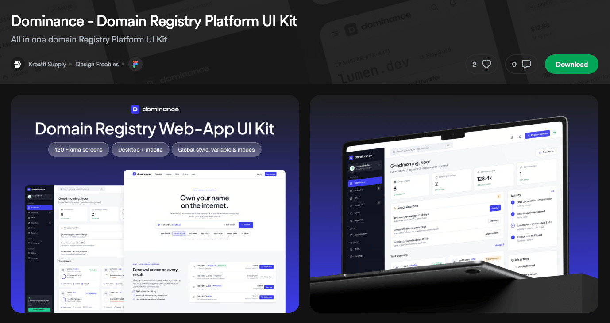

# Dominance

## Overview
Dominance is a modern platform designed to give you complete control over your domain portfolio. It brings essential tools and information together in one intuitive environment, making domain management simple, efficient, and seamless.

Monitor domain status, keep track of expiration dates, and manage all your domain-related information in one place. Regardless of the size of your portfolio, Dominance provides the visibility, convenience, and control you need to stay on top of your digital assets.

## Design Credits
The UI/UX design used in this project is based on the **Dominance – Domain Registry Platform UI Kit**, created by **Kreatif Supply**.

- Original UI Kit: [Dominance – Domain Registry Platform UI Kit](https://ui8.net/kreatif-supply/products/dominance---domain-registry-platform-ui-kit)
- Website: [www.kreatif.supply](https://www.kreatif.supply/)

All rights to the original design and assets belong to their respective owners.